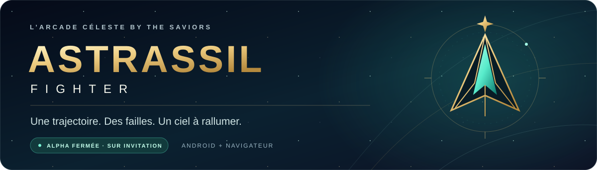
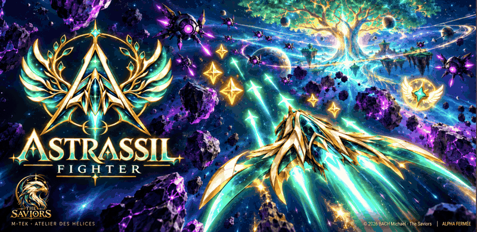

<p align="center">
  
</p>

<p align="center">
  <a href="https://momolscode.github.io/astrassil-fighter-beta-downloads/"><strong>✦ PAGE OFFICIELLE</strong></a>
  &nbsp; · &nbsp;
  <a href="https://aberdeen-kansas-tour-lower.trycloudflare.com/jeu/"><strong>▶ JOUER DANS LE NAVIGATEUR</strong></a>
  &nbsp; · &nbsp;
  <a href="https://github.com/Momolscode/astrassil-fighter-beta-downloads/releases/download/alpha-fermee-0.6.5-code19/astrassil-fighter-0.6.5-alpha-fermee.19-code19-release-signe.apk"><strong>↓ APK ANDROID</strong></a>
</p>

<p align="center"><strong>Une trajectoire. Des failles. Tout un ciel à rallumer.</strong><br>Un jeu d’arcade spatial sur Android et navigateur.</p>

<p align="center">
  <picture>
    <source media="(prefers-reduced-motion: reduce)" srcset="./assets/jaquette-alpha-fermee.png">
    
  </picture>
  <br><sub>Jaquette officielle mise en mouvement · illustration de l’univers, pas une capture de partie.</sub>
</p>

## Choisissez votre envol

| En solo | En coopération | Votre vaisseau |
| --- | --- | --- |
| Une campagne de **60 failles**, puis une **progression procédurale dès le palier 61**. | Des expéditions distinctes de **2 à 4 joueurs**, sur **30 failles coop**. | Un hangar pour préparer votre équipement avant de rejoindre le vol. |

En coop, un groupe joue une seule expédition à la fois. Les déblocages sont validés par le serveur, séparément de la campagne solo. La coop ne verse actuellement **ni XP ni écus**. Elle ne constitue pas une campagne solo complète partagée, un monde persistant ou un ensemble de modes multijoueurs.

## Rejoindre l’alpha

**L’accès exige une invitation personnelle du propriétaire. Télécharger l’application ne crée pas de droit d’accès.**

1. Ouvrez [Compte et première inscription](https://aberdeen-kansas-tour-lower.trycloudflare.com/connexion) dans votre navigateur. Pour un premier compte Android, utilisez **Chrome ou Firefox** : invitation, Google, fiche joueur, puis identifiants Astrassil.
2. Jouez dans le navigateur, ou installez l’[APK Android signé](https://github.com/Momolscode/astrassil-fighter-beta-downloads/releases/download/alpha-fermee-0.6.5-code19/astrassil-fighter-0.6.5-alpha-fermee.19-code19-release-signe.apk). Dans l’application, choisissez **« J’ai déjà un identifiant Astrassil »** et retrouvez ce même compte sans nouvelle clé.
3. Conservez la [page officielle](https://momolscode.github.io/astrassil-fighter-beta-downloads/) : elle réunit les liens actuels, le téléchargement et le guide.

Google dans le WebView Android n’est pas activé ni qualifié ; aucune ouverture automatique du navigateur n’est promise. Sur le Web, Google permet aussi de retrouver un compte déjà lié. L’association à un compte existant doit être choisie explicitement depuis ce compte ; aucun regroupement par adresse courriel identique n’est effectué.

## Android et mises à jour

**APK actuelle : 0.6.5-alpha-fermee.19 · code 19 · paquet `com.unum.astrassil`**

Les correctifs Web compatibles sont chargés depuis le serveur. Un nouveau conteneur APK s’installe **manuellement**, en conservant l’application et ses données. Le certificat de signature est identique aux versions précédentes. Ce paquet n’embarque pas un jeu complet hors ligne et ne s’installe pas silencieusement.

Le paquet est construit, signé et vérifié. **Aucun essai du code 19 sur téléphone physique n’est revendiqué.**

<details>
<summary>Vérifier le fichier Android</summary>

Taille : **9 571 603 octets**.

SHA-256 :

```text
4d444f6c152d03c220644c8ada93235eab3bd1fc17f17d825f24f4bdd1088187
```

[Voir la version Android sur GitHub](https://github.com/Momolscode/astrassil-fighter-beta-downloads/releases/tag/alpha-fermee-0.6.5-code19)

</details>

## Avant de décoller

Le serveur de test fonctionne sur le PC de l’équipe derrière un relais HTTPS provisoire. Une connexion et un service disponibles sont nécessaires. Une déconnexion ou un redémarrage peut interrompre une expédition ; ne supposez pas qu’un combat en cours sera repris. Conservez le même compte et ne videz pas les données avant de vérifier vos sauvegardes. Les archives de secours chiffrées sont contrôlées séparément ; une copie récente peut encore attendre son passage périodique.

Les écus et l’inventaire relèvent du jeu. Aucun achat d’objet en euros n’est activé par ce lot. Un éventuel soutien extérieur reste distinct et ne donne ni accès, ni objet, ni bonus.

Pour l’aide, utilisez le canal privé ayant transmis votre invitation. **Ne publiez jamais clé, mot de passe ou données de compte.** Les anciennes captures, le livret PDF et les aperçus ne suffisent pas à qualifier une fonctionnalité ajoutée depuis leur réalisation.

<p align="center">
  <a href="https://momolscode.github.io/astrassil-fighter-beta-downloads/documents/ASTRASSIL-FIGHTER-Guide-de-vol-Alpha.pdf">Guide de vol illustré</a>
  &nbsp; · &nbsp;
  <a href="https://momolscode.github.io/astrassil-fighter-beta-downloads/confidentialite.html">Confidentialité</a>
  &nbsp; · &nbsp;
  <a href="https://momolscode.github.io/astrassil-fighter-beta-downloads/informations-test.html">Informations du test et éditeur</a>
</p>

<p align="center"><sub>© 2026 BACH Michael · The Saviors<br>L’arcade céleste · Projet porté par MTech · Alpha fermée en développement</sub></p>
